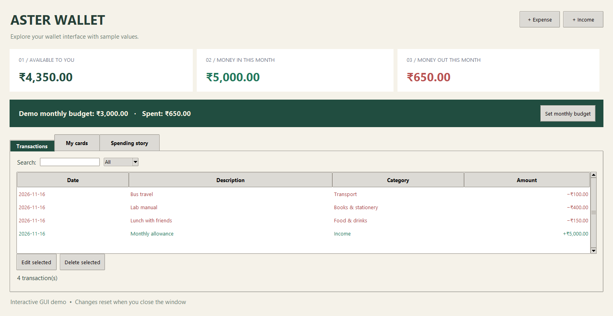
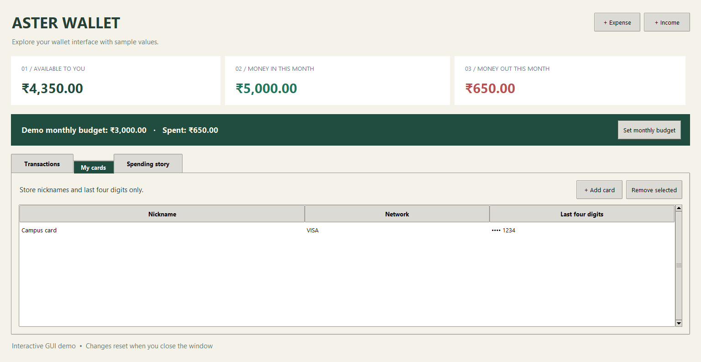
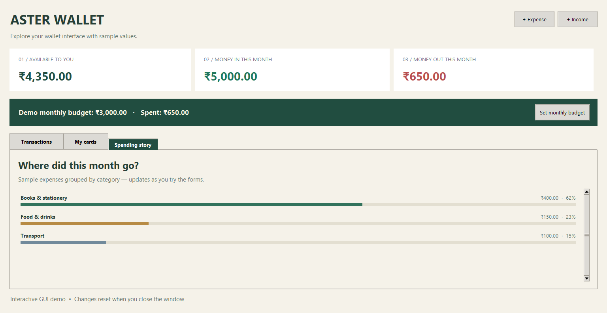

# Aster Wallet

A standalone **Python Tkinter GUI** for a student wallet interface. It uses Python's standard library and opens with fictional sample transactions and a sample card.

All interactions change temporary values in the open window. Closing and reopening the app restores the sample values. Nothing you enter is saved or exported.

## Run

Install Python 3.10 or newer with Tkinter, then double-click **Start Wallet.bat** on Windows, or run:

```powershell
py main.py
```

On macOS/Linux, run `python3 main.py`. Your Linux distribution may require the `python3-tk` package. No pip packages are required.

## Interface

- Cream and forest-green theme with balance, income and expense displays.
- Transactions tab with search, income/expense filtering and interactive forms.
- Add, edit or remove sample entries and see the display update.
- My cards tab with masked references and add/remove controls.
- Spending story tab with a scrollable Tkinter Canvas category chart.
- Monthly budget dialog and immediate input feedback.
- Ctrl+N opens the expense form. Enter submits a form and Escape closes it.

## UI screenshots

Screenshots show fictional values from the GUI demo.

### Transactions



### My cards



### Spending story



## Project files

- `main.py`: the complete GUI, sample values and widget callbacks.
- `test_app.py`: checks that exercise the actual Tkinter controls.
- `Start Wallet.bat`: Windows launcher.
- `SUBMISSION_GUIDE.md`: project explanation and demonstration steps.
- `preview/`: screenshots of the interface.

## Verification

```powershell
py -m unittest -v
```

Tests briefly open Tkinter windows. They check navigation, search, form validation, edits, removal, cards, budget changes and reset on reopening.

See [the submission guide](SUBMISSION_GUIDE.md) for the college demonstration.
