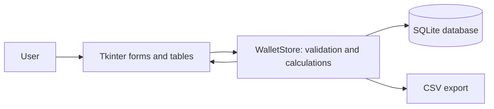

# Aster Wallet — project submission guide

## Project abstract

Aster Wallet is an offline student money journal developed with Python, Tkinter and SQLite. It records allowance and expenses, organizes spending into categories, and calculates a suggested daily spending amount from the remaining monthly budget and available wallet balance. A category chart explains spending patterns. The application supports adding, viewing, searching, editing, deleting and exporting transaction records, along with managing masked card references.

## Problem and objectives

Students often record purchases in scattered notes and cannot easily tell how much allowance remains. This project provides a single local ledger with immediate balance updates and understandable spending feedback.

Objectives: accurate calculations, persistent storage, input validation, clear navigation, a useful student-specific budget calculation, and maintainable code that can be demonstrated offline.

## Architecture

`main.py` handles interface widgets and events. `wallet_model.py` handles storage and money rules. Automated tests use disposable databases, keeping real records separate.

## Database design

| Table | Key fields | Purpose |
|---|---|---|
| transactions | id, title, amount, category, day | Signed ledger entries; positive income, negative expense |
| cards | id, name, last4, network, color | Card references; no full card number |
| settings | key, value | Monthly budget and application preferences |

Amounts are integer paise. Transaction dates use ISO format. Balance is computed from the ledger rather than stored as a second potentially inconsistent value. SQL values are supplied through parameters. The card color field is retained for compatibility with the shared storage format.

## Main algorithms

1. Balance = sum of all signed transaction amounts.
2. Monthly spending = absolute sum of negative entries in the current month.
3. Remaining budget = monthly budget minus monthly spending.
4. Spendable amount = max(0, min(remaining budget, current wallet balance)).
5. Suggested daily allowance = spendable amount divided by remaining calendar days, including today; integer division keeps the result within the budget.
6. An edit checks `current balance - old amount + new amount >= 0` before saving.
7. A deletion checks `current balance - deleted amount >= 0`, preventing removal of income already spent.

The daily allowance is a simple planning indicator, not financial advice or a prediction of future income.

## Five-minute demonstration

Use `py main.py --data college-demo.db` to create an isolated empty demonstration wallet.

1. Introduce the student problem and the three tabs.
2. Add ₹5,000 as monthly allowance; show the updated balance.
3. Set the monthly budget to ₹3,000.
4. Add ₹150 for lunch, ₹400 for a lab manual and ₹100 for bus travel.
5. Open Spending story and explain category proportions and the daily allowance.
6. Search for the lab manual, edit its amount to ₹350 and show recalculation.
7. Attempt an expense larger than the balance; explain validation.
8. Add a dummy card reference with last four digits `1234`, then remove it.
9. Export CSV, close the application and reopen the same database to demonstrate persistence.
10. Run `py -m unittest -v` and explain one accounting test and one GUI integration test.

## Testing and evidence

Tests cover decimal input, negative/invalid amounts, overdrafts, edit/delete accounting, search, CSV formula escaping, card validation, persistence and saving through the actual income form. Run the suite and record its actual output for your submission. Capture your own screenshots of the demo and insert them into your college's required report format.

## Viva questions to prepare

- Why SQLite? It is embedded, persistent, requires no server and supports transactions.
- Why integer paise? Binary floating-point arithmetic can introduce rounding errors in currency calculations.
- How does Tkinter update the GUI? The event loop dispatches callbacks; forms call the model and refresh displayed data.
- What is CRUD here? Create an entry, read/search it, update it using Edit, and delete it after confirmation.
- Why use a database transaction? A validation check and its dependent write must succeed together; write locking protects the balance check from competing writers.
- What prevents SQL injection? User-supplied values use parameterized SQL statements.
- Why are test databases temporary? Tests should be repeatable and must not modify personal records.
- What happens if income is deleted? Deletion is rejected if the resulting balance would be negative.
- What is the difference between budget and balance? Budget is a spending limit; balance is money remaining in the ledger.
- Does it connect to a bank? No. Users enter transactions manually.

## Limitations and possible improvements

The app is single-user, INR-only and local. It does not encrypt its database, synchronize devices, reconcile bank transactions or handle transfers between accounts. Deletion has confirmation but no undo or audit log. Large transaction lists currently use Python-side filtering. Possible extensions include SQL-backed pagination, recurring expenses, encrypted backups and multiple wallets.

## Submission checklist

- Add your actual name, roll number, course and supervisor to the college cover sheet.
- Map the implemented features to your institution's rubric.
- Include source, README, database design, screenshots, actual test output and references.
- Explain any reused code and AI assistance according to your college's rules.
- Rehearse the demo and modify a small feature yourself so you can explain the code confidently.
- Exclude your personal database and financial records from the submission.

References: Python Tkinter documentation, Python sqlite3 documentation, Python decimal documentation and the SQLite documentation. The visual identity is an original cream-and-forest student journal theme.
